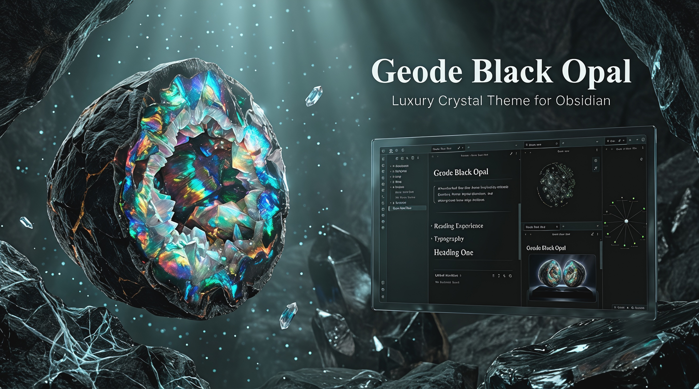
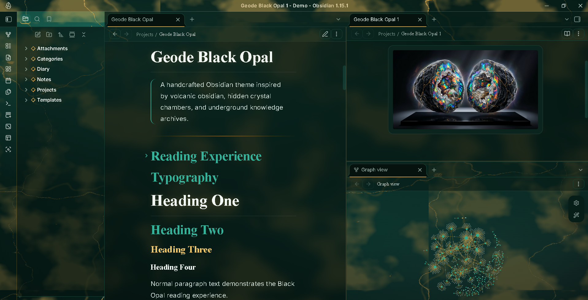
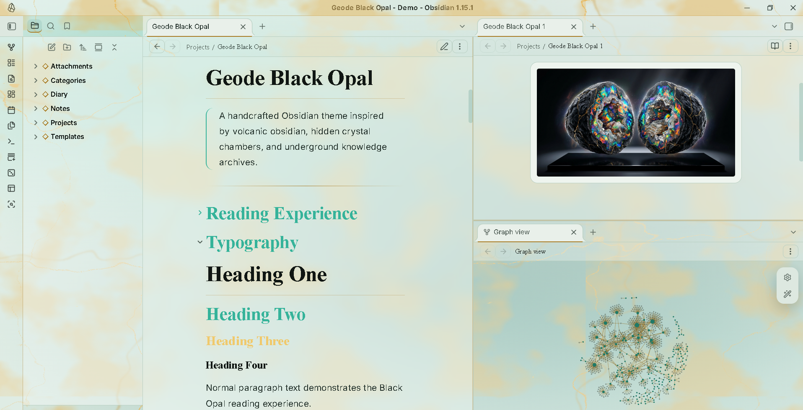

# 💚 GEODE — MALACHITE & GOLD

<p align="center">
  
  
  
  
  
</p>

<p align="center">
  <em>Not every gem belongs in a jewelry box. Some belong in your workspace.</em>
</p>

---

## 💎 A Little Obsidian. A Little Obsession.

Meet **Geode** — where deep malachite meets liquid gold.

Inspired by hidden mineral chambers, ancient marble, and nature's most beautiful imperfections, Geode transforms Obsidian into something a little more extraordinary.

Gold veins wander through organic stone. Glass surfaces reveal hidden depths. Every panel feels like opening another layer of a geode.

And the best part?

**Beauty doesn't have to get in the way of getting things done.**

---

## ✨ Preview



---

## 🌗 Two Moods. One Beautiful Mind.

### 🌑 Dark Mode



Deep malachite shadows, mysterious mineral textures, and golden veins glowing beneath the surface.

*For midnight thinkers and beautifully unfinished ideas.*

### ☀️ Light Mode



Soft mineral surfaces, delicate gold accents, and transparent glass panels.

*For daylight discoveries and fresh beginnings.*

---

## 💚 What's Inside the Stone?

| Feature | What Makes It Special |
|---|---|
| 💎 Procedural Marble | Organic SVG textures and gold veins |
| ✨ Gold Veins | Adjustable pattern scale and intensity |
| 🪟 Glass Interface | Whole-app transparency |
| 🎛 Style Settings | Customize without touching CSS |
| 📖 Full-Width Editor | Room for thoughts to breathe |
| 📝 Framed Reading | Optional centered 850px glass card |
| 🗂 Properties | Flat, minimal metadata styling |
| 🕸 Graph View | Malachite-inspired network visuals |
| 🧩 Plugin Styling | Dataview, Bases, Kanban and more |
| 📱 Mobile Ready | Responsive layouts and performance tuning |

---

## 🎨 The Geode Design System

A little science behind all that sparkle.

| Layer | Purpose |
|---|---|
| Malachite | Deep mineral-inspired surfaces |
| Gold | Veins, accents and visual highlights |
| Glass | Translucent interface panels |
| Marble | Organic procedural backgrounds |
| Zone Veils | Adjustable transparency layers |

### ⚙️ Make It Yours

Geode comes with native **Style Settings** integration.

No CSS surgery required.

| Customization | Control |
|---|---|
| Ribbon Veil | Adjust opacity |
| Chrome Veil | Adjust sidebars and tabs |
| Editor Veil | Control background visibility |
| Status Bar Veil | Adjust transparency |
| Modal Veil | Control modal appearance |
| Graph Veil | Adjust graph background |
| Pattern Scale | Change vein size |
| Pattern Intensity | Control gold visibility |

**Extra switches:**
- Framed Card Reading Layout
- Disable Glass Blur
- Hide Gold Veins

Your workspace. Your atmosphere. Your rules.

---

## 📖 A Workspace That Knows When to Step Back

Geode gives your ideas room to breathe.

<details>
<summary><strong>📚 Reading & Writing</strong></summary>

- Full-width editor by default.
- Full-width reading view.
- Optional centered 850px reading card.
- Frosted-glass card surface.
- Gold seam border and subtle shadow.

</details>

<details>
<summary><strong>🗂 Properties & Metadata</strong></summary>

- Auto-width property keys.
- Minimal backgrounds and borders.
- Custom gold checkbox indicators.
- Styled dropdowns and multi-select pills.
- Improved mobile touch targets.

</details>

<details>
<summary><strong>🧩 Plugin Compatibility</strong></summary>

| Plugin / Feature | Integration |
|---|---|
| Dataview | Tables, lists and cards |
| Bases | Panel and table styling |
| Kanban | Solid lanes and gold hover effects |
| Calendar | Integrated interface styling |
| Excalidraw | Styling containment |
| Graph View | Custom nodes, links and tags |
| Tasks | Integrated task styling |

</details>

---

## ⚡ Beautiful, Without Burning Through Your Battery

A pretty workspace should still feel fast.

| Optimization | Benefit |
|---|---|
| No-Blur Mode | Reduced rendering overhead |
| Mobile Detection | Performance-conscious blur |
| Reduced Motion | Respects system preferences |
| High Contrast | Stronger interface borders |
| Solid Form Fields | Consistent text readability |

Geode supports:

- `prefers-reduced-motion`
- `prefers-contrast: high`
- `geode-no-blur`

---

## 💠 The Evolution — v1.0.1

From dark crystal to living mineral.

| | Black Opal | Malachite & Gold |
|---|---|---|
| Aesthetic | Obsidian & cyan | Malachite & gold |
| Background | Radial gradients | Procedural marble |
| Customization | Static CSS | Style Settings |
| Transparency | Limited glass | Whole-app transparency |
| Reading | Fixed 850px | Full width + optional card |
| Properties | Boxed | Flat & minimal |
| Performance | Standard blur | Adjustable blur |
| Mobile | Basic responsive | Dedicated optimizations |

**This isn't just a new coat of paint. It's a new geological era.**

---

## 🛠 Installation

1. Download or clone this repository.
2. Place the theme folder inside:

```text
YourVault/.obsidian/themes/
```

3. Open Obsidian.
4. Navigate to **Settings → Appearance → Themes**.
5. Select **Geode**.
6. Install and enable the **Style Settings** community plugin to unlock customization.

---

## 📁 Inside the Geode

```text
Geode-Malachite-Gold/
│
├── theme.css
├── manifest.json
├── README.md
├── LICENSE
├── screenshot.png
│
└── screenshots/
    ├── dark.png
    └── light.png
```

---

## 🔤 The Typography

| Purpose | Typeface |
|---|---|
| Body | Inter |
| Headings | Cormorant Garamond |
| Code | JetBrains Mono |

A modern voice, an editorial soul, and a little mineral magic.

---

## ☕ Keep the Gold Flowing

Enjoying Geode? Help keep its veins glowing.

<p align="center">
  <a href="https://www.buymeacoffee.com/CosmicSeaFox">
    
  </a>
  <br><br>
  <a href="https://ko-fi.com/cosmicseafox">
    
  </a>
</p>

Every bit of support helps nurture future improvements. 💚

---

## 📜 Credits & License

**Fonts:** Inter · Cormorant Garamond · JetBrains Mono

**Made for:** The Obsidian community.

**License:** MIT — see [LICENSE](LICENSE).

---

<p align="center">
  <strong>GEODE — MALACHITE & GOLD</strong>
  <br>
  <em>Dig deeper. Think clearer. Stay golden. 💚</em>
  <br><br>
  <sub>Version 1.0.1 · Made with love for the curious.</sub>
</p>